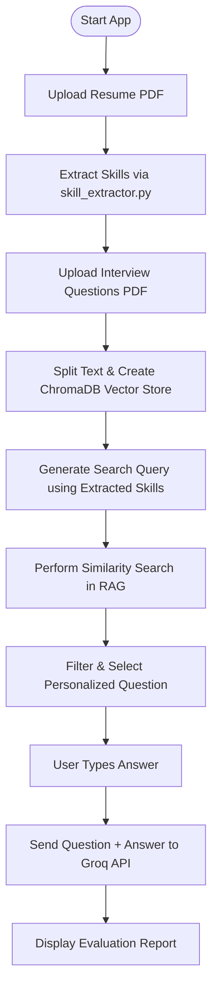

# 💼 InterviewGPT — Your Personalized AI Interview Coach

InterviewGPT is an intelligent, RAG-powered desktop web application that acts as a personal technical interviewer. By analyzing a candidate's resume, it dynamically generates highly relevant interview questions tailored to their specific skillset and provides comprehensive AI-driven feedback on their answers.

Powered by **Streamlit**, **Groq**, **LangChain**, **ChromaDB**, and **HuggingFace** embeddings.

[](https://www.python.org/)
[](https://streamlit.io/)
[](https://groq.com/)
[](https://www.langchain.com/)
[](#)

---

## 📌 Table of Contents

- [Overview](#-overview)
  - [What Makes InterviewGPT Useful?](#what-makes-interviewgpt-useful)
- [Features](#-features)
- [Technology Stack](#-technology-stack)
- [How It Works](#-how-it-works)
  - [Pipeline Flowchart](#pipeline-flowchart)
  - [Processing Pipeline](#processing-pipeline)
- [Project Structure](#-project-structure)
- [Prerequisites](#-prerequisites)
- [Installation](#-installation)
- [Configuration](#-configuration)
- [Run InterviewGPT](#-run-interviewgpt)
- [Web Interface Guide](#-web-interface-guide)
- [Troubleshooting](#-troubleshooting)
- [Security Best Practices](#-security-best-practices)
- [Future Improvements](#-future-improvements)
- [License](#-license)
- [Acknowledgements](#-acknowledgements)

---

## 🚀 Overview

InterviewGPT solves a major problem in interview preparation: generic, irrelevant questions. Instead of pulling random questions from a static list, InterviewGPT uses **Retrieval-Augmented Generation (RAG)** to personalize the entire experience.

When a user uploads their resume, the application extracts their technical skills (e.g., Python, SQL, NLP). These skills are then passed directly into the RAG retrieval system as a search query against a knowledge base of interview questions. The result is a targeted, realistic technical question. After the user submits their answer, the Groq API evaluates the response and returns a detailed scorecard covering technical accuracy, communication, and missing concepts.

### What Makes InterviewGPT Useful?

- **Hyper-Personalized:** Questions are generated based on *your* resume, not a random question pool.
- **Strict Skill Filtering:** The RAG system guarantees that generated questions map directly to your detected expertise.
- **Instant AI Feedback:** Receive grades out of 10, strengths, weaknesses, and an improved model answer.
- **Professional UI:** A clean, dark-themed Streamlit dashboard designed for a distraction-free interview session.
- **Private & Secure:** API keys and user resumes are processed in-session and never stored permanently.

---

## ✨ Features

### 📄 Resume Parsing & Skill Extraction
- Upload resumes in PDF format.
- Automatically extracts raw text using `pdfplumber`.
- Scans for technical keywords (e.g., Python, SQL, Machine Learning, LangChain) and displays them as interactive UI badges.

### 🧠 Personalized RAG Retrieval
- Converts the uploaded Interview Questions PDF into vector embeddings using HuggingFace (`all-MiniLM-L6-v2`).
- Stores embeddings in **ChromaDB** for fast similarity search.
- **Constraint Implementation:** The extracted resume skills are injected into the search query (`"Technical interview questions about {skills}"`).
- Strict text filtering ensures the LLM does not hallucinate or return off-topic questions.

### 📊 AI Answer Evaluation
- Powered by the **Groq API** (Llama-3 / high-throughput open LLMs).
- Evaluates technical answers in real time.
- Provides a structured scorecard including:
  - Technical Accuracy Score (out of 10)
  - Communication & Clarity Score (out of 10)
  - Identified Strengths & Weaknesses
  - Key Missing Concepts
  - An "Improved Model Answer" generated by the AI

### 🖥️ Modern Web Interface
- Built with Streamlit for a fast, responsive user journey.
- Features custom CSS styling for a dark-mode aesthetic.
- Employs `st.session_state` for state persistence across interactions.
- Guided step-by-step layout (Upload Resume $\rightarrow$ Upload Questions $\rightarrow$ Generate $\rightarrow$ Evaluate).

---

## 🛠️ Technology Stack

| Technology | Category | Purpose |
|---|---|---|
| **Python 3.10+** | Language | Core runtime and application logic |
| **Streamlit** | Frontend | Web interface and session state management |
| **Groq API** | LLM Engine | Fast inference for answer evaluation and grading |
| **LangChain** | Orchestration | Document loading, text splitting, and retrieval pipelines |
| **ChromaDB** | Vector Database | Local vector store for document indexing and retrieval |
| **HuggingFace** | Embeddings | Sentence-transformers (`all-MiniLM-L6-v2`) |
| **pdfplumber** | Extraction | Precise PDF text extraction from candidate resumes |
| **PyPDF** | Parsing | Document parsing for technical question banks |
| **python-dotenv** | Security | Environment variable and API key isolation |

---

## ⚙️ How It Works

### Pipeline Flowchart



### Processing Pipeline

1. **Resume Processing:** The user uploads a resume. `pdfplumber` extracts the text, and `skill_extractor.py` identifies technical keywords.
2. **Knowledge Base Indexing:** The technical questions PDF is chunked, embedded via HuggingFace sentence-transformers, and stored in ChromaDB.
3. **Targeted Retrieval:** The RAG system takes the candidate's extracted skills, builds a targeted query, and queries ChromaDB.
4. **Question Generation:** The system filters retrieved chunks to ensure a valid, relevant, and well-formed question is returned.
5. **Evaluation:** The user submits their answer. The Groq API acts as a Senior Technical Interviewer to grade the response and provide actionable feedback.

---

## 📁 Project Structure

```text
InterviewGPT/
│
├── app.py                  # Main Streamlit UI and state management
├── rag.py                  # Vector store creation and RAG retrieval logic
├── evaluator.py            # Groq API integration for answer grading
├── resume_parser.py        # PDF text extraction for resumes
├── skill_extractor.py      # Keyword matching for technical skills
│
├── .env                    # Local API configuration (keep secret, not committed)
├── .gitignore              # Files excluded from version control
├── requirements.txt        # Python package dependencies
├── start_project.bat       # Automated launch script for Windows
└── README.md               # Project documentation
```

> [!NOTE]
> Keep `.env` strictly local. Ensure `venv/`, `__pycache__/`, and `.env` remain listed in your `.gitignore`.

---

## 📋 Prerequisites

Before installing InterviewGPT, ensure you have:

- **Operating System:** Windows, macOS, or Linux.
- **Python:** Version 3.10 or newer.
- **Network Connection:** Required for Groq API calls and the initial HuggingFace model download.
- **Groq API Key:** Available from the [Groq Console](https://console.groq.com/).
- **Input Documents:**
  - A PDF resume with selectable text.
  - A PDF containing interview questions (e.g., *"Python Interview Questions.pdf"*).

Check your installed Python version:

```bash
python --version
```

---

## 📥 Installation

### 1. Clone the Repository
Open your terminal and clone the repository to your desired directory:

```bash
git clone https://github.com/yourusername/InterviewGPT.git
cd InterviewGPT
```

### 2. Create a Virtual Environment

- **Windows:**
  ```bash
  python -m venv venv
  venv\Scripts\activate
  ```

- **macOS / Linux:**
  ```bash
  python3 -m venv venv
  source venv/bin/activate
  ```

### 3. Install Dependencies
Upgrade `pip` and install all required packages:

```bash
python -m pip install --upgrade pip
pip install -r requirements.txt
```

> [!NOTE]
> The first time you run the application, HuggingFace will download the `all-MiniLM-L6-v2` embedding weights. This initial setup may take 1–2 minutes depending on your internet connection.

---

## 🔐 Configuration

InterviewGPT uses environment variables to keep your API keys separate from the source code.

### 1. Set Up the `.env` File
Create a `.env` file in the project root directory:

```env
GROQ_API_KEY=your_groq_api_key_here
```

Get your API key from the [Groq Console](https://console.groq.com/). **Do not commit this file to GitHub.**

### 2. Environment Variables

| Variable | Required | Description |
|---|---|---|
| `GROQ_API_KEY` | **Yes** | API key used for Groq LLM inference and evaluation |

### 3. Configuration Checklist
- [ ] The `.env` file exists in the project root directory.
- [ ] `GROQ_API_KEY` contains a valid API key string.
- [ ] `.env` is listed inside `.gitignore`.
- [ ] The selected Groq model (e.g., `llama-3.3-70b-versatile` or `openai/gpt-oss-120b`) is accessible on your account.

---

## ▶️ Run InterviewGPT

With your virtual environment activated, start the Streamlit application:

```bash
streamlit run app.py
```

Alternatively, on Windows, you can launch the app using the provided batch script:

```bash
start_project.bat
```

### Startup Behavior
Streamlit will launch a local server and open a new tab in your default web browser (typically at `http://localhost:8501`), greeting you with the InterviewGPT dashboard.

---

## 🖥️ Web Interface Guide

The application follows three clear steps:

1. **Step 1: Candidate Profile**
   - Upload your resume in PDF format.
   - The app extracts your background and displays detected technical skills as colored badges (e.g., `PYTHON`, `SQL`, `NLP`).

2. **Step 2: Knowledge Base**
   - Upload a PDF containing technical interview questions.
   - The application indexes the questions into ChromaDB using dense vector embeddings.

3. **Step 3: Generate & Evaluate**
   - Click **"Generate Personalized Interview Question"**.
   - The RAG system queries the database using your extracted skills and displays a targeted question.
   - Type your answer in the text box and click **"Evaluate Answer"**.
   - Review your detailed diagnostic scorecard generated by Groq.

---

## 🛠️ Troubleshooting

### `GROQ_API_KEY is missing` or `AuthenticationError`
- Check that `.env` is in the project root (not in a subfolder).
- Ensure the key has no accidental quotation marks or leading/trailing spaces.
- Verify your API key status and quota in the [Groq Console](https://console.groq.com/).

### Model Not Found (`404 Error`)
- If you receive an error like `The model ... does not exist or you do not have access to it`, update the `model="..."` string in `evaluator.py`. Groq periodically updates active model IDs.
- *Recommended models:* `llama-3.3-70b-versatile` or other currently active Groq models.

### ChromaDB or HuggingFace Errors
- Ensure you have an active internet connection on the first run to allow model downloading.
- If dependency conflicts occur with `protobuf` or `numpy`, recreate your virtual environment and run a fresh installation:
  ```bash
  deactivate
  rm -rf venv  # on Windows: rmdir /s /q venv
  python -m venv venv
  pip install -r requirements.txt
  ```

### "No technical skills detected"
- Make sure your resume PDF contains selectable, extractable text rather than scanned images without an OCR layer.
- Check `skill_extractor.py` to confirm that your domain skills are present in the `SKILLS` keyword list.

### Streamlit UI Glitches or State Reset
- Clear your browser cache or open the app in an Incognito/Private window.
- Restart the local server (`Ctrl + C` in your terminal, then re-run `streamlit run app.py`).

---

## 🔒 Security Best Practices

- **Protect API Credentials:** Never hardcode your Groq API key in Python files.
- **Exclude Secrets from Git:** Keep `.env` explicitly declared in `.gitignore`.
- **Rotate Exposed Keys:** If an API key is accidentally pushed publicly, revoke and replace it immediately via the Groq Console.
- **Trusted Dependencies:** Only install Python packages from trusted sources through `requirements.txt`.

---

## 🚀 Future Improvements

- [ ] Voice-to-text integration for real-time verbal mock interviews.
- [ ] Ingestion support for multiple file formats (`.docx`, `.txt`, `.md`).
- [ ] A persistent "History & Progress" tab to track past interview scores and improvement over time.
- [ ] User authentication (OAuth / Supabase) to retain interview sessions across devices.
- [ ] Customizable interviewer personas (e.g., *Strict Staff Architect* vs. *Friendly Startup Mentor*).
- [ ] Automated unit and retrieval evaluation tests for the RAG pipeline.

---

## 📄 License

This project does not currently include an open-source license. All rights are reserved by the original author. If you plan to distribute this repository or accept external contributions, consider adding an appropriate open-source license such as the [MIT License](https://opensource.org/licenses/MIT) or [Apache 2.0](https://www.apache.org/licenses/LICENSE-2.0).

---

## ⭐ Acknowledgements

InterviewGPT is built on top of the open-source AI ecosystem:

- [Streamlit](https://streamlit.io/) — Fast interactive UI framework
- [Groq](https://groq.com/) — High-speed LLM inference
- [LangChain](https://www.langchain.com/) — Document chunking and retrieval orchestration
- [ChromaDB](https://www.trychroma.com/) — Embedded vector store
- [HuggingFace](https://huggingface.co/) — Sentence-transformers embedding models
- [pdfplumber](https://github.com/jsvine/pdfplumber) — PDF text parsing